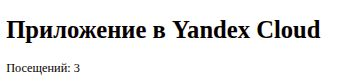

# Веб-приложение в Yandex Cloud

Я использую Terraform для сети, двух подсетей, виртуальной машины, управляемой MySQL и Container Registry. Cloud-init ставит Docker и плагин Compose на Ubuntu. Приложение показывает счётчик посещений, который хранится в MySQL.

```text
Браузер → публичный IP VM:80 → Docker Compose → приложение
                                                 ↓ TLS
                                       Managed MySQL:3306
VM → Container Registry за образом
VM → Lockbox за паролем
Terraform → Object Storage за state, YDB за блокировкой
```

## Подготовка

1. Выбрать каталог в `yc` и проверить его командой `yc resource-manager folder get "$(yc config get folder-id)"`.
2. Подготовить приватный бакет Object Storage с версионированием и таблицу `state-lock` в Serverless YDB через Document API. У таблицы строковый ключ раздела `LockID`. Выдать отдельной сервисной учётной записи доступ к бакету и Document API. Настроить её S3-учётные данные через `AWS_ACCESS_KEY_ID` и `AWS_SECRET_ACCESS_KEY` в окружении.
3. Создать секрет Lockbox с ключом `password` и случайным паролем длиной от 8 до 128 символов. У исполнителя Terraform должно быть право чтения содержимого этого секрета.
4. Скопировать `infra/backend.hcl.example` в `infra/backend.hcl`, а `infra/terraform.tfvars.example` в `infra/terraform.tfvars`. Указать ID секрета и его версии, доступный класс MySQL, публичный SSH-ключ и CIDR для SSH. Для работы нужен Terraform с поддержкой write-only аргументов и блокировки через DynamoDB API.

Для state использую отдельный приватный бакет. Источник данных Lockbox сохраняет полученное значение в Terraform state, хотя атрибут пользователя MySQL `password_wo` сам пароль не сохраняет. Для смены пароля создать новую версию секрета и увеличить `password_revision` одновременно со сменой `secret_version_id`.

## Развёртывание

Команды выполняются из корня проекта. Первый запуск создаёт реестр и базу, второй создаёт VM после публикации образа.

```bash
export YC_CLOUD_ID="$(yc config get cloud-id)"
export YC_FOLDER_ID="$(yc config get folder-id)"
export YC_TOKEN="$(yc iam create-token)"

terraform -chdir=infra init -backend-config=backend.hcl
terraform -chdir=infra validate
terraform -chdir=infra plan
terraform -chdir=infra apply

repo="$(terraform -chdir=infra output -raw repository)"
tag=v1
yc container registry configure-docker
docker buildx build --provenance=false --platform linux/amd64 --push -t "$repo:$tag" .

terraform -chdir=infra plan -var="image_tag=$tag"
terraform -chdir=infra apply -var="image_tag=$tag"
```

После успешного запуска сохранить тег в `terraform.tfvars` для дальнейших запусков Terraform. При обновлении публиковать новый тег. Изменение тега пересоздаёт VM и может изменить её публичный IP. Данные счётчика остаются в MySQL.

VM получает токен своей сервисной учётной записи через метаданные. С этим токеном она скачивает образ и читает заданную версию секрета. Пароль монтируется в контейнер из временной файловой системы VM. MySQL принимает подключения на 3306 от группы безопасности приложения. Порты 80 и 443 разрешены группой VM. Приложение обслуживает HTTP на порту 80. Для HTTPS на 443 потребуется отдельная настройка TLS.

## Проверка

```bash
url="$(terraform -chdir=infra output -raw web_url)"
ip="$(terraform -chdir=infra output -raw web_ip)"
ssh "deploy@$ip" 'cloud-init status --wait && sudo docker compose version && sudo systemctl is-active yandex-web'
curl -fsS "$url/health"
curl -fsS "$url/"
curl -fsS "$url/"
```

Ожидаемый ответ `/health` содержит `{"status":"ok"}`. Два запроса главной страницы последовательно увеличивают счётчик. Фактический результат запуска и подтверждения собраны ниже.

## Ссылки

- [Блокировка Terraform state в Yandex Cloud](https://yandex.cloud/ru/docs/terraform/tutorials/terraform-state-lock)
- [Загрузка образов в Container Registry](https://yandex.cloud/ru/docs/container-registry/operations/docker-image/docker-image-push)
- [Управление пользователями Managed MySQL](https://yandex.cloud/ru/docs/managed-mysql/operations/cluster-users)
- [Целевой репозиторий](https://github.com/Anton-Sergeev-EA/Terraform)

## Результаты развёртывания

Проект размещён в отдельном каталоге `course-web-terraform`. Образ `web:v1` опубликован в Container Registry. Хеш манифеста `sha256:ae86ce48e8eb5542e2fdf389a3091ec6fbce827291c72b0635c1864aa14af094`.

Удалённый state настроен в закрытом бакете с версионированием. Во время применения плана второй процесс Terraform получил ошибку получения блокировки. [Результат проверки блокировки](evidence/state-lock.md).

Перед остановкой приложение отвечало по адресу `http://51.250.10.42/`. Cloud-init завершился успешно, `/health` вернул `{"status":"ok"}`, а два запроса к странице увеличили счётчик с 1 до 2. Итоговый `terraform plan` подтвердил совпадение конфигурации с инфраструктурой. [Проверка запуска](evidence/cloud-run.md) · [Образ и удалённый state](evidence/registry-and-state.md).



После проверки я остановил контейнер, VM и кластер MySQL. Для VM и кластера подтверждён статус `STOPPED`. Исторический IP указан для отчёта. При повторном старте актуальный адрес нужно посмотреть в облаке.

## Повторный показ

В учебном каталоге сначала запустить Managed MySQL и дождаться статуса `RUNNING`, затем запустить VM. Обе команды ждут завершения операции.

```bash
folder="$(yc resource-manager folder get --name course-web-terraform --format json | jq -r .id)"
yc managed-mysql cluster start course-web --folder-id "$folder"
yc compute instance start course-web --folder-id "$folder"
yc compute instance get course-web --folder-id "$folder" --format json \
  | jq -r '.network_interfaces[0].primary_v4_address.one_to_one_nat.address'
```

Открыть текущий IP по HTTP и после показа остановить контейнер, VM и MySQL. Для остановки контейнера на VM выполнить `sudo docker compose --project-directory /opt/yandex-web --env-file /opt/yandex-web/settings stop`. Если у MySQL ещё нет резервной копии, перед остановкой создать её. У остановленной базы отдельно тарифицируются хранилище и резервные копии. [Остановка и запуск Managed MySQL](https://yandex.cloud/ru/docs/managed-mysql/operations/cluster-stop).
